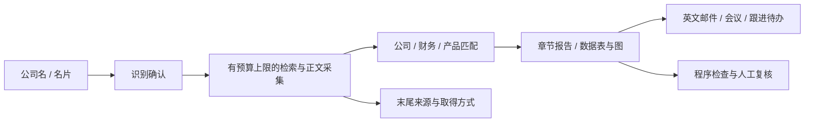
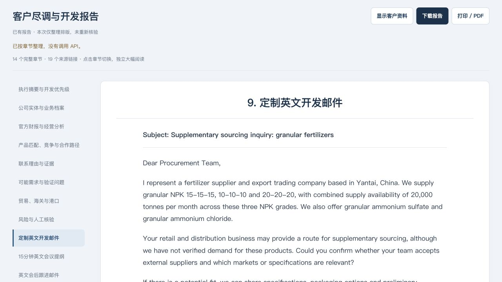
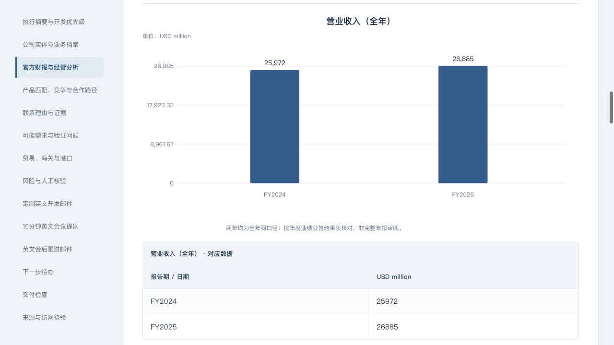

# AI 外贸客户研究助手

Local-first B2B company research and outreach drafts, with a web UI and an optional MCP interface.

输入公司名称，或上传并确认名片信息，整理客户业务、财务、产品匹配、合作风险和英文开发材料。项目从化肥外贸销售场景出发，帮助业务员判断“下一步值得核验什么、该联系哪个职能”。

**0.4.0 预览版。** 已跑通本机联网研究和官方 MCP SDK 调用；自动报告仍需人工核验。目前提供源码及启动脚本，尚无经过实机验证的 Windows/Mac 通用安装包。

[快速启动](#快速启动) · [历史示例](examples/Nutrien-reviewed-demo.md) · [MCP 接入](docs/MCP.md) · [验证与限制](docs/VALIDATION.md)

## 从客户信息到下一步行动

- 公司实体：区分集团、子公司、采购职能和投资者关系渠道。
- 财报与经营：保留期间、币种、单位和缺项；合格数据同时展示表与图。
- 销售匹配：区分产品重叠、潜在合作与已经取得的买方证据。
- 贸易与海关：不混淆销量、产量、产能、出口量和公司级逐票记录。
- 开发材料：英文开发信、15分钟会议提纲、会后模板及负责人/日期待办。
- 使用体验：文字和照片同页、OCR后确认、输入栏收起、单章阅读、Markdown导入/下载与打印入口。

正文两端对齐，邮件按信件左对齐，来源集中末尾。下图使用历史人工修订报告，仅展示界面与输出结构。

## 快速启动

1. 准备 **Python 3.10+**、系统 `curl`，以及自己的 **DeepSeek官方API Key**，并确保账户接口权限、余额及网络可用。
2. 下载仓库ZIP并完整解压，或克隆仓库。不要只下载 `index.html`。
3. Mac双击 `start.command`；Windows双击 `start.bat`（尚待Windows实机验证）。备用方式是在项目目录运行 `python3 launcher.py`，Windows可用 `python launcher.py`。
4. 首次启动会创建项目 `.venv` 并尝试安装 `requirements.txt`，自动打开 **本地网页**（http://127.0.0.1:8767/）。
5. 网页右上角「连接设置」填写自己的密钥，可选保存到系统凭据库，下次自动使用。凭据库不可用时仅支持本次内存，不改用明文文件。

**不要双击 `index.html` 直接使用。** 静态页面不能调用后台，新页面会给正确入口提示。源码启动模式下，关闭运行窗口会停止服务。

密钥不用交给作者，不写进仓库、Issue或截图。保存成功不等于网络认证成功。API费用走使用者账户，ChatGPT会员不抵扣API费。

填公司名称，建议附国家和官网以减少同名误配；补充我方产品、规格和供货边界。名片识别字段先确认再研究。重要结论与交易条件由人复核，程序不会发送邮件。

无需API的体验：展开「查看已有报告」，导入 `examples/Nutrien-reviewed-demo.md`。它是**历史人工修订示例**，不是模型一次生成即全部合格的证明，也不是最新公司事实或信用结论。

## 两个入口，共用研究逻辑

| 入口 | 适用对象 | 内容 |
|---|---|---|
| 本地网页 | 直接操作的业务员 | 输入、照片、报告、图表与导出 |
| stdio MCP | 支持对应协议的AI客户端 | 调用 `research_company`，共用研究与检查逻辑 |

MCP需要客户端配置；把仓库链接发给任意助手不代表自动安装。参见[MCP说明](docs/MCP.md)。

## 数据与边界

- 当前使用DeepSeek官方模型、Search/Fetch接口；不保证第三方转发密钥兼容。检索与生成分开，检索预算由程序限制。
- 应用在本机运行，但提示词、研究上下文、搜索词及点击识别的照片会发给对应服务；不经过作者服务器。仅处理获授权资料。
- 只把实际取得的正文节选用于事实生成；搜索摘要不冒充已读原文。链接和结构检查不能证明全部事实或财务语义正确。
- 没有付费公司级海关逐票数据库，不保证全年进出口或各港口完整覆盖。
- 图表不猜值补点，不用单点股价画趋势，不混画年度与季度。
- 默认规则围绕化肥外贸示例；切换产品/行业需核对 `research_prompt.md` 和 `quality/`，避免模板与卖方资料冲突。

## 验证与贡献

[验证记录](docs/VALIDATION.md)区分离线测试、真实调用、人工修订和未验证事项。业务侧贡献包括场景与需求定义、报告结构、供应商身份/供货量规则、输出验收、错误反馈和迭代，代码开发使用AI辅助。

本次为**私有源码预览**，尚未选择对外开源许可证。正式公开与发布通用安装包前，另行完成许可选择、跨设备验证及发布审查。
